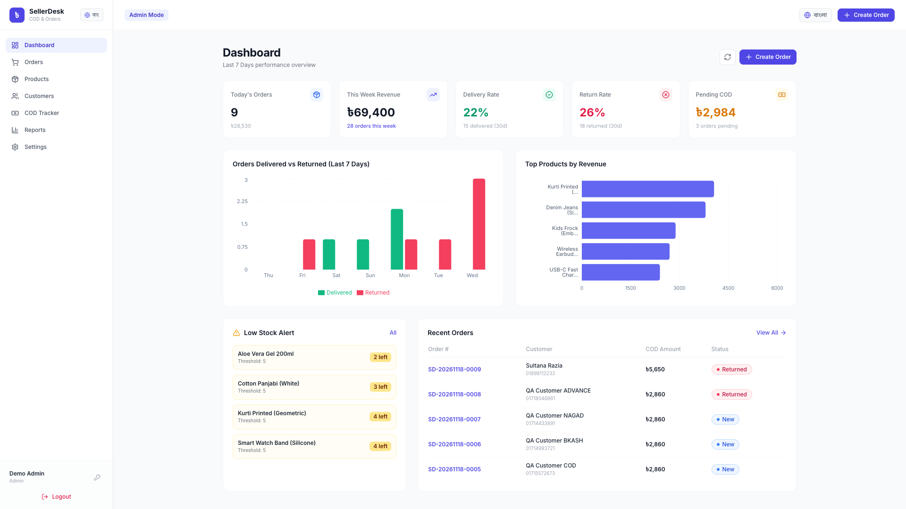
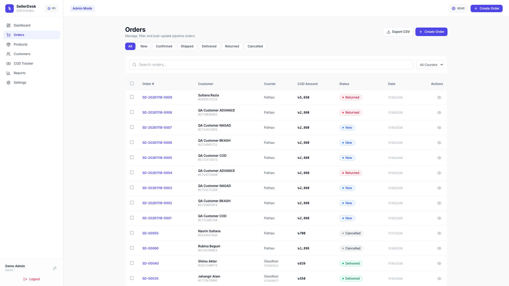
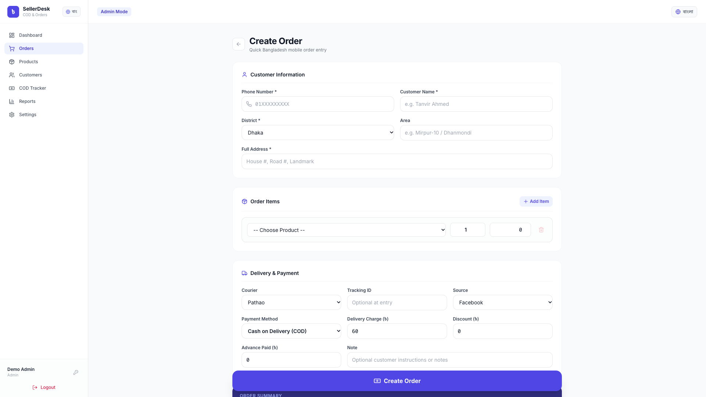
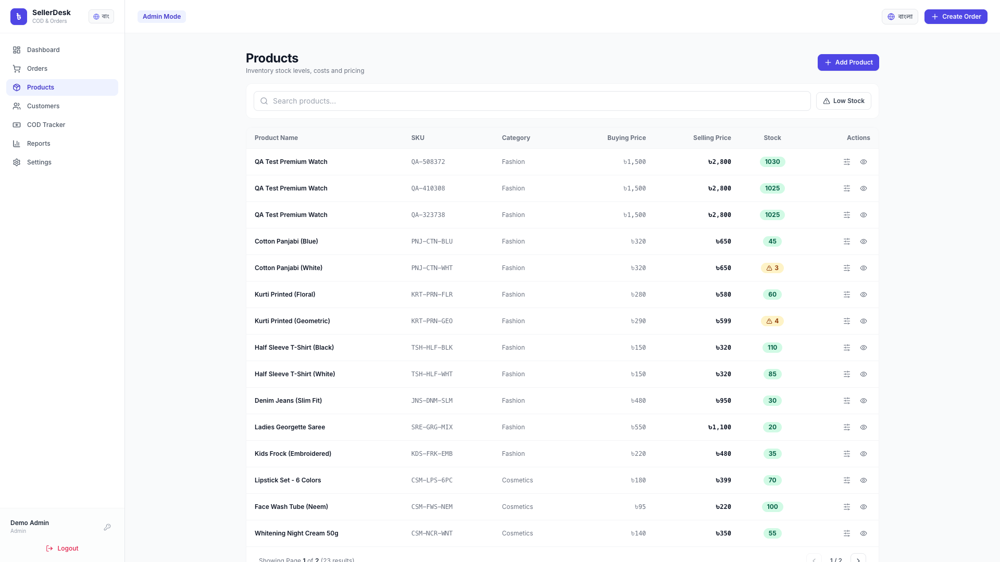
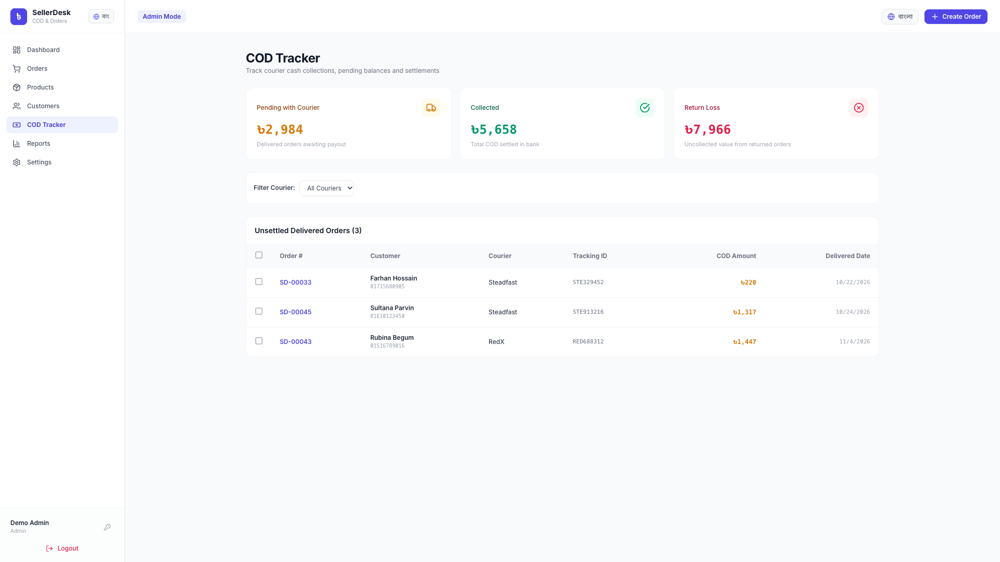
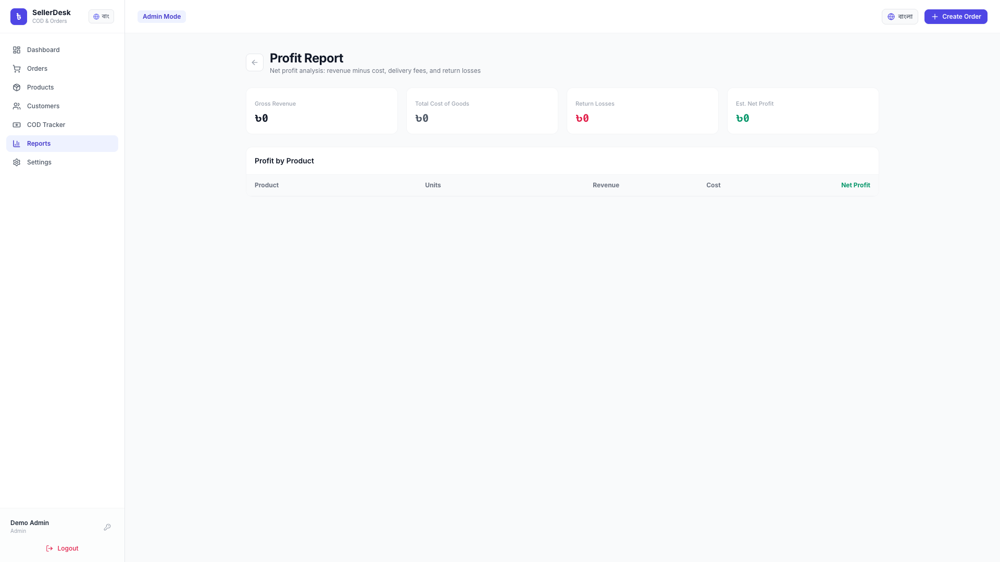

# SellerDesk 🛒

> **Multi-Tenant Order, Inventory & COD Manager for Social Commerce Sellers (Facebook, Instagram & WhatsApp)**

[](https://nodejs.org/)
[](https://react.dev/)
[](https://www.sqlite.org/)
[](https://mysql.com/)
[](LICENSE-NOTE.md)
[](VIBE96_LISTING.md)

SellerDesk is a modern, lightweight, multi-tenant order pipeline, automated stock control, and courier cash-on-delivery (COD) settlement system designed specifically for social commerce merchants. It eliminates spreadsheet errors, prevents inventory overselling, reconciles courier payouts, and provides real-time net profit analytics with strict tenant isolation.

---

## 📸 Product Screenshots (1920 × 1080)

| Sales & Operational Dashboard | Order Pipeline & Lifecycle |
| :---: | :---: |
|  |  |

| Mobile-First Quick Order Entry | Products Catalog & Stock Control |
| :---: | :---: |
|  |  |

| Cash on Delivery (COD) & Settlement | Net Profit & Financial Analytics |
| :---: | :---: |
|  |  |

---

## ✨ Main Features

### 🏢 Genuine Multi-Tenant Architecture
- **Tenant Isolation**: Distinct merchant workspaces powered by the `sellers` table and foreign key scoping on all operational records.
- **Cross-Seller Security**: Absolute isolation across orders, products, stock movements, customers, settings, and financial analytics.
- **Tenant RBAC**: Admin and Staff accounts scoped strictly within each merchant organization.

### 🛍️ Mobile-First Quick Order Entry
- **Optimized for Touch Usage**: Generous touch targets (≥ 38px), minimal taps, and clear layout.
- **Returning Customer Auto-Fill**: Instant lookup by phone number automatically fills customer name and address.
- **Bangladesh Phone Validation**: Regex validation for 11-digit mobile numbers (`01XXXXXXXXX`).
- **Duplicate Order Alerts**: Warns merchants immediately if the same phone number placed an order recently.
- **Multi-Item & Payments**: Add multiple products/variants, set delivery charges, discounts, and payment methods (COD, bKash, Nagad, Bank, Advance).

### 📦 Order Pipeline & Status Lifecycle
- **Visual Status Tracker**: Seamlessly advance orders through `New` → `Confirmed` → `Shipped` → `Delivered` → `Returned` → `Cancelled`.
- **Courier Logistics**: Integrated fields for Pathao, Steadfast, RedX, Paperfly, and custom couriers with tracking IDs.
- **Printable Invoices & Slips**: A4-ready invoice generator with customer details, item breakdown, and courier dispatch slip.
- **Bulk Status Updates**: Transition multiple orders simultaneously within the tenant.
- **Audit History**: Complete chronological log of status changes and user accountability.

### 📊 Real-Time Inventory & Stock Audit
- **Automatic Stock Reservation**: Stock is automatically deducted when an order is `Confirmed`.
- **Automatic Return Restorations**: Returned or cancelled orders automatically restore stock units.
- **Low-Stock Notifications**: Configurable alerts for products dropping below safety thresholds.
- **Stock Movement Log**: Audit log for manual restocking, damage, and corrections.

### 💰 Cash on Delivery (COD) Tracker & Courier Settlement
- **COD Reconciliation**: Track pending COD balances against delivered orders in real-time.
- **Batch Courier Settlements**: Reconcile courier disbursements, deduct courier fees, and track net payouts.
- **Multi-Channel Coverage**: Supports bKash, Nagad, Bank Transfer, COD, and Advance partial payments.

### 📈 Financial Reports & Executive Analytics
- **Live Performance Dashboard**: 7-day revenue/volume charts, delivery success rate KPIs, and low-stock alerts.
- **Net Profit Calculations**: Real-time margin report: `Gross Revenue - (Cost of Goods Sold + Delivery Expenses)`.
- **Role Isolation**: Profit metrics and margins are strictly hidden from staff accounts.

---

## 🧰 Technology Stack

| Layer | Technologies |
| :--- | :--- |
| **Frontend** | React 18.3.1, React Router v6.27, Tailwind CSS v3.4, `@tanstack/react-query` v5, React Hook Form v7, Recharts v2.13, Lucide React, `i18next` (English + বাংলা). Located in `React Vite Web/`. |
| **Backend** | Node.js 18+ / 20+ LTS, Express 4.18, Helmet, CORS Whitelist, `express-rate-limit`, Joi validation. Located in `Node Express API/`. |
| **Database** | Dual Mode: **SQLite** (bundled via `better-sqlite3`, WAL mode) & **MySQL / MariaDB** (via `mysql2`). |
| **Auth** | Stateless JWT (HS256) with tenant `seller_id`, `bcryptjs` password hashing (12 rounds), login rate limiting. |
| **Testing** | Supertest (API integration & tenant isolation), Puppeteer CDP (Headless Chrome E2E automation). |
| **Deployment** | Docker & Docker Compose (MariaDB + API), Linux VPS (systemd + Nginx + Certbot). |

---

## ⚡ Quick Start (< 60 Seconds with SQLite)

SellerDesk runs out of the box with zero external database installation required!

### 1. Clone & Install
```bash
git clone <your-repository-url> sellerdesk
cd sellerdesk
npm install
```

### 2. Run the Automated Setup Wizard
```bash
npm run setup
```
*This command creates `.env` from `Node Express API/.env.example`, installs server and client dependencies, applies database migrations, and seeds multi-tenant demo data.*

### 3. Start Development Server
```bash
npm run dev
```

- **Frontend**: `http://localhost:5173`
- **Backend API**: `http://localhost:5001`

---

## 🔑 Demo Accounts

The database comes pre-seeded with multi-tenant merchant accounts:

### Tenant 1 — Fashion House BD
| Role | Email | Password | Privileges |
| :--- | :--- | :--- | :--- |
| **Administrator** | `admin@demo.com` | `Admin@123` | Full access, settings, user management, profit reports. |
| **Staff Member** | `staff@demo.com` | `Staff@123` | Operational access to orders, products, customers, COD tracker. |

### Tenant 2 — Gadget Planet (Multi-Tenancy Verification)
| Role | Email | Password | Privileges |
| :--- | :--- | :--- | :--- |
| **Administrator** | `seller2@demo.com` | `Seller2@123` | Independent tenant workspace, separate products and orders. |
| **Staff Member** | `staff2@demo.com` | `Staff2@123` | Operational staff for Tenant 2. |

---

## ⚙️ Environment Variables

Configuration is handled through `.env`. Exactly one `.env.example` file is provided in `Node Express API/.env.example`:

```ini
# Application Environment
NODE_ENV=development
PORT=5001

# Security & Authentication
JWT_SECRET=your_secure_jwt_secret_min_32_characters
JWT_EXPIRES_IN=7d

# CORS Settings
CORS_ORIGIN=http://localhost:5173

# Database Selection ('sqlite' or 'mysql')
DB_CLIENT=sqlite
SQLITE_FILE=./database/sellerdesk.sqlite

# MySQL / MariaDB Settings (used when DB_CLIENT=mysql)
DB_HOST=127.0.0.1
DB_PORT=3306
DB_USER=sellerdesk
DB_PASSWORD=your_secure_db_password
DB_NAME=sellerdesk
```

---

## 🛠️ Development & Testing Commands

```bash
# Start both client and server concurrently
npm run dev

# Run API integration, tenant isolation and RBAC security tests
npm test

# Run Google Chrome headless E2E automation suite
node scripts/e2e-runner.js

# Build client assets for production
npm run build

# Start production server
npm start
```

---

## 🚀 Production Deployment

SellerDesk includes two validated production deployment options:

1. **Linux VPS Deployment (systemd + Nginx + SSL)**: Detailed step-by-step instructions available in [DEPLOYMENT.md](DEPLOYMENT.md).
2. **Docker & Docker Compose**: Starts MariaDB 10.6 database service and SellerDesk application with persistent volumes:
   ```bash
   docker compose up -d --build
   ```

---

## 📄 License & Commercial Distribution

SellerDesk is released under commercial distribution terms on Vibe96. All production dependencies utilize permissive open-source licenses (MIT, BSD, ISC). Commercial redistribution, private hosting, and client deployment are permitted under marketplace terms. See [LICENSE-NOTE.md](LICENSE-NOTE.md) and [THIRD_PARTY_LICENSES.md](THIRD_PARTY_LICENSES.md).
